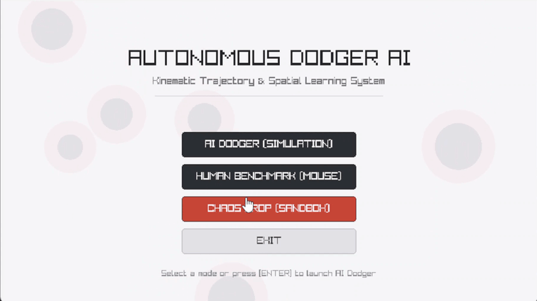
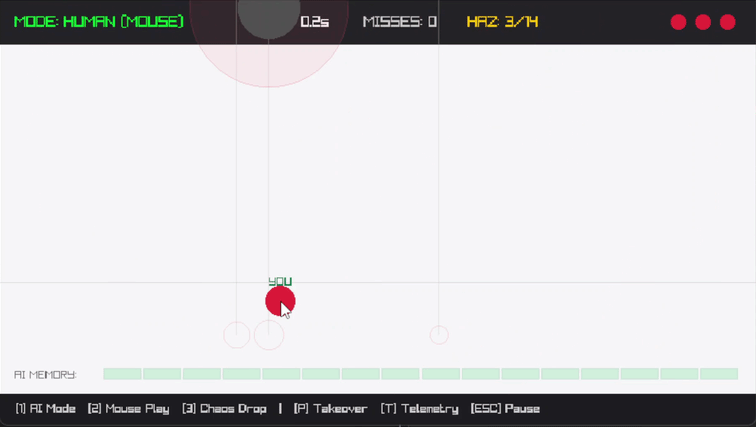
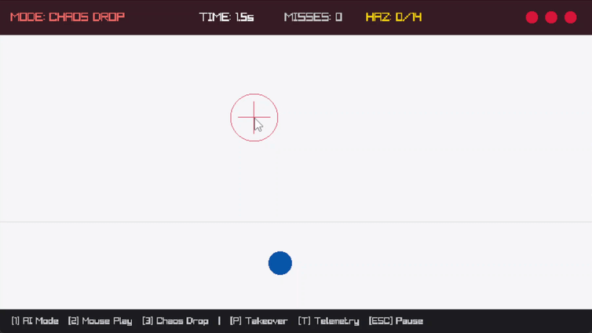
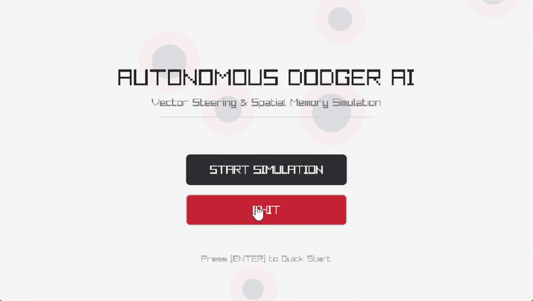
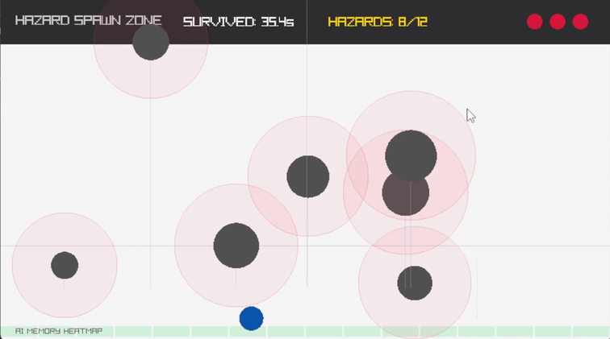
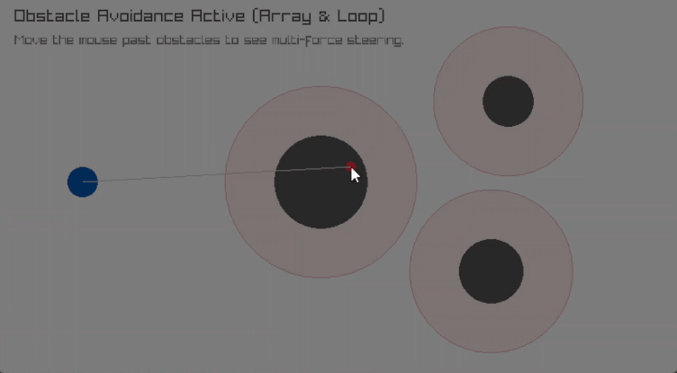

# 2D Autonomous AI Dodger (Raylib + C)

A lightweight 2D game AI simulation built in C using Raylib. The project demonstrates low-level game engineering fundamentals without external physics engines: normalized vector mathematics, Artificial Potential Fields (APF) for real-time obstacle avoidance, kinematic trajectory prediction, spatial memory learning grids, dynamic difficulty scaling, and interactive multi-mode simulation suites.

---

## Version 3: Multi-Mode Simulation & Interactive Sandbox

### Mode 0: Autonomous AI Dodger

Autonomous agent evasive maneuvering powered by kinematic trajectory interception, repulsive potential field vectors, and 16-column spatial memory pathfinding.



### Mode 1: Human Benchmark (Direct Mouse Control)

Direct cursor positioning enabling human benchmark runs against the procedural falling hazard engine.



### Mode 2: Chaos Drop (Interactive Sandbox)

Interactive spawner mode allowing the user to drop custom boulders directly onto the AI agent with real-time mouse-wheel radius scaling.



---

## Version 2: Predictive Trajectory and Spatial Learning

### Dynamic Hazards and Trajectory Prediction

Real-time kinematic Time-to-Impact (TTI) projection lines and proximity-fading impact reticles on the arena floor.



### Spatial Memory Heatmap and Collision Learning

Dynamic 16-column spatial risk grid that stamps localized penalties upon damage and linearly decays over time.



---

## Version 1: Steering and Static Avoidance

Basic vector normalization steering and static circle-to-circle obstacle avoidance.



---

## Tech Stack

- **Language:** C
- **Framework:** Raylib 6.0 (the root CMake configuration fetches this version by default)
- **Audio:** Raylib audio module (miniaudio backend by default)
- **Toolchain:** Visual Studio 2022 (MSVC) / CMake / GCC / Clang

---

## Core Systems

- **Vector Steering:** Normalized Euclidean unit vectors for directional steering.
- **Repulsive Potential Fields (APF):** Imminent threat evaluation exerting proximity-scaled repulsive velocity offsets away from hazard centers.
- **Kinematic Trajectory Prediction:** Time-to-impact estimates and floor-intercept landing reticles.
- **Spatial Memory Grid:** 16-column learning array tracking historical collision damage with linear time decay (`2.0 units/sec`).
- **Interactive Multi-Mode Architecture:** Transitions between Autonomous AI, Human Benchmark, and Chaos Sandbox modes.
- **Live Takeover:** Real-time switching between autonomous AI steering and player cursor control during a simulation.
- **Visual Telemetry Toggle:** Toggle (`[T]`) for debug overlays, force rays, trajectory lines, APF influence bubbles, and the spatial heatmap bar.
- **Dynamic Difficulty:** Procedural hazard density scaling from 3 up to 14 simultaneous falling projectiles (`+1 hazard every 6.5 s`).
- **State Machine UI:** Pause Menu (`[ESC]`) and Game Over overlay with selective memory retention (`[R]`) or complete memory reset (`[C]`).

---

## Controls & Hotkeys

| Key / Input | Action |
| :--- | :--- |
| `[1]` | Switch to **Mode 0: AI Dodger** (Autonomous Simulation) |
| `[2]` | Switch to **Mode 1: Human Benchmark** (Direct Mouse Control) |
| `[3]` | Switch to **Mode 2: Chaos Drop** (Interactive Sandbox) |
| `[P]` | **Live Takeover Toggle** (switch between AI and mouse control) |
| `[T]` | **Toggle Telemetry UI** (show/hide trajectory lines, reticles, APF bubbles, and memory heatmap) |
| `[ESC]` | **Toggle Pause Menu** |
| `[R]` | **Restart Run** (retain learned spatial risk memory) |
| `[C]` | **Restart & Clear Memory** (reset the spatial memory heatmap) |
| `[M]` | **Return to Title Menu** |
| `Mouse Wheel` | *(Chaos Mode)* Adjust spawned boulder radius (`16 px–56 px`) |
| `Left Click` | *(Chaos Mode)* Drop a custom boulder at cursor coordinates |

---

## AI Math Breakdown

### 1. Vector Seeking (Normalized Directional Steering)

To steer toward a target coordinate, the agent calculates a directional displacement vector and normalizes it by Euclidean distance:

$$
\Delta x = x_{\text{target}} - x_{\text{agent}}, \quad \Delta y = y_{\text{target}} - y_{\text{agent}}
$$

$$
\text{distance} = \sqrt{\Delta x^2 + \Delta y^2}
$$

$$
\vec{v}_{\text{seek}} = \left( \frac{\Delta x}{\text{distance}}, \frac{\Delta y}{\text{distance}} \right)
$$

#### Variable Glossary
* $x_{\text{agent}}, y_{\text{agent}}$: Current 2D Cartesian coordinates of the AI agent's center.
* $x_{\text{target}}, y_{\text{target}}$: World-space coordinates of the destination point (such as the center of the safest corridor column).
* $\Delta x, \Delta y$: The directional displacement vector components (run and rise) from the agent to the target.
* $\text{distance}$: The straight-line scalar distance (Euclidean $L_2$ norm) between the agent and target.
* $\vec{v}_{\text{seek}}$: The normalized unit direction vector ($\|\vec{v}_{\text{seek}}\| = 1.0$).

#### How It Works
1. **Displacement:** Subtracting the agent's position from the target's position provides an unconstrained vector pointing directly toward the goal.
2. **Euclidean Metric:** The Pythagorean theorem computes the scalar magnitude. If $\text{distance} = 0$, normalization is bypassed to guard against division-by-zero errors.
3. **Unit Normalization:** Dividing $\Delta x$ and $\Delta y$ by $\text{distance}$ strips magnitude information while preserving pure direction. Multiplying $\vec{v}_{\text{seek}}$ by the agent's baseline movement speed ensures uniform movement velocity regardless of how close or far the target is.

---

### 2. Obstacle Evasion (Artificial Potential Fields - APF)

When inside an obstacle's detection radius ($R_{\text{danger}}$), the agent computes a repulsive vector pointing away from the hazard center, scaled by proximity and temporal urgency:

$$
\text{panic} = \frac{R_{\text{danger}} - \text{distance}}{R_{\text{danger}}}
$$

$$
W_{\text{urgency}} = \min\left(3.0, \frac{1.0}{t_{\text{impact}} + 0.3}\right)
$$

$$
\vec{v}_{\text{avoid}} = \left( \frac{\Delta x}{\text{distance}} \cdot \text{panic} \cdot W_{\text{urgency}} \cdot 3.6,\; \frac{\Delta y}{\text{distance}} \cdot \text{panic} \cdot 1.5 \right)
$$

#### Variable Glossary
* $R_{\text{danger}}$: Threat radius of the hazard (physical circle radius plus the agent's safety detection margin).
* $\text{distance}$: Current Euclidean distance between the center of the agent and the center of the hazard.
* $\text{panic}$: Normalized proximity ratio bounded between $[0.0, 1.0]$.
* $t_{\text{impact}}$: Kinematically projected time (in seconds) until the hazard reaches the agent's floor baseline.
* $W_{\text{urgency}}$: Time-to-impact urgency multiplier.
* $\Delta x, \Delta y$: Relative positional offset measured from the hazard center to the agent center ($x_{\text{agent}} - x_{\text{hazard}}, y_{\text{agent}} - y_{\text{hazard}}$), directing the repulsive force outward.
* $3.6 \text{ and } 1.5$: Directional anisotropy bias multipliers for lateral ($X$) and vertical ($Y$) evasion axes.
* $\vec{v}_{\text{avoid}}$: The resulting repulsive velocity adjustment added to the agent's net steering sum.

#### How It Works
1. **Proximity Penetration (`panic`):** When an obstacle touches the outer threshold ($\text{distance} = R_{\text{danger}}$), $\text{panic} = 0.0$ and generates zero force. As the obstacle approaches center-to-center contact ($\text{distance} \to 0$), $\text{panic} \to 1.0$. This creates an inverse-linear falloff where closer objects exert progressively stronger defensive pressure.
2. **Temporal Threat Scaling ($W_{\text{urgency}}$):** Spatial proximity alone is incomplete in a dynamic environment; an obstacle passing overhead at high vertical velocity is far more dangerous than one moving slowly. Scaling inversely with $t_{\text{impact}}$ causes hazards about to hit the floor to generate massive repulsion. The $+0.3$ damping offset prevents mathematical singularities (division by zero) when $t_{\text{impact}} \to 0$, and $\min(3.0, \dots)$ caps maximum force to prevent physics clipping.
3. **Anisotropic Lateral Bias:** The horizontal component is scaled by $3.6$ while the vertical component is scaled by $1.5$. Because hazards descend along the Y-axis, escaping laterally along the X-axis is fundamentally more effective than attempting to outrun or jump over hazards vertically.

---

### 3. Kinematic Trajectory Prediction

For falling projectiles, the agent estimates the time remaining until the obstacle crosses the agent baseline altitude ($d_{\text{floor}}$) and predicts its landing position.

```math
d_{\text{floor}} = y_{\text{floor}} - y_{\text{hazard}}
```

```math
t_{\text{impact}} = \frac{d_{\text{floor}}}{v_y} \cdot \frac{1}{60}
```

```math
x_{\text{projected}} = x_{\text{hazard}} + \frac{v_x}{v_y} \cdot d_{\text{floor}}
```

#### Variable Glossary

- `FLOOR_Y`: The constant Y-coordinate of the baseline floor where the agent operates. In the equations above, it is represented by $y_{\text{floor}}$.
- $x_{\text{hazard}}$, $y_{\text{hazard}}$: The current horizontal and vertical coordinates of the falling projectile.
- $d_{\text{floor}}$: The remaining vertical distance the hazard must travel to reach the floor.
- $v_x$, $v_y$: The horizontal and vertical velocity components of the hazard, measured in pixels per frame tick.
- $\frac{1}{60}$: The conversion factor from simulation frame ticks to seconds, assuming 60 FPS.
- $t_{\text{impact}}$: The estimated time until impact, measured in seconds.
- $x_{\text{projected}}$: The predicted horizontal coordinate where the hazard's trajectory intersects the floor.

#### How It Works

1. **Vertical Distance:** Calculate the remaining distance between the hazard and the floor.
2. **Time to Impact:** Divide the remaining vertical distance by the downward velocity to estimate the number of remaining frame ticks, then convert to seconds.
3. **Landing Prediction:** Estimate the hazard's horizontal movement during its fall to determine where it will reach the floor. This allows the AI to anticipate incoming threats and move away before impact.

Obstacles with imminent impact times receive immediate evasion priority over hazards higher in the arena.

---

### 4. Spatial Risk Learning and Decay

The floor corridor is segmented into 16 discrete columns (`50 px` each). When hit, a localized penalty is stamped into the active and neighboring columns:

$$
\text{riskHeatmap}[\text{col}_{\text{hit}}] \mathrel{+}= 55.0, \quad \text{riskHeatmap}[\text{col}_{\text{hit}} \pm 1] \mathrel{+}= 22.0
$$

During every frame tick, historical risk decays linearly:

$$
\text{riskHeatmap}[i] = \max\left(0.0,\; \text{riskHeatmap}[i] - 2.0 \cdot \Delta t\right)
$$

The agent evaluates candidate column safety by minimizing:

$$
\text{Score} = \text{riskHeatmap}[\text{col}] + \sum \left( \text{proximity} \cdot \frac{15.0}{t_{\text{impact}} + 0.25} \right) + \left( \frac{\text{travelDist}}{\text{ScreenWidth}} \right) \cdot 9.0 + \text{Penalty}_{\text{corner}}
$$

#### Variable Glossary
* $\text{col}_{\text{hit}}$: The index ($0 \le i < 16$) of the spatial column where a physical collision occurred.
* $\text{riskHeatmap}[i]$: Floating-point risk scalar stored in memory for column $i$.
* $55.0 \text{ and } 22.0$: Direct-hit penalty and neighbor dispersion penalty (discrete Gaussian kernel approximation).
* $2.0$: Linear decay rate of damage memory per elapsed second.
* $\Delta t$: Delta time between the previous and current frame ticks (`GetFrameTime()`).
* $\text{Score}$: Total composite threat value for a candidate column (lower is safer).
* $\text{proximity}$: A normalized falloff scalar $[0.0, 1.0]$ representing how close a hazard's projected landing point $x_{\text{projected}}$ is to the candidate column center.
* $\frac{15.0}{t_{\text{impact}} + 0.25}$: Dynamic threat multiplier for incoming projectiles approaching the candidate column.
* $\frac{\text{travelDist}}{\text{ScreenWidth}} \cdot 9.0$: Travel cost heuristic penalizing distant columns to prevent erratic back-and-forth oscillation.
* $\text{Penalty}_{\text{corner}}$: Edge boundary bias added to the leftmost and rightmost columns ($i = 0$ and $i = 15$) to prevent the agent from trapping itself against arena walls.

#### How It Works
1. **Damage Imprinting:** Upon taking damage, the agent identifies the strike column and stamps a large penalty ($+55.0$), while dispersing a secondary splash penalty ($+22.0$) to adjacent columns. This creates a localized "hot zone" that discourages the AI from returning to recent impact sites.
2. **Linear Forgetting Function:** Without decay, the entire arena would eventually become flagged as unsafe. The linear subtraction term ($2.0 \cdot \Delta t$) combined with $\max(0.0, \dots)$ ensures the heatmap gradually resets to zero over time, allowing the AI to re-explore previously dangerous columns once hazards clear.
3. **Multi-Objective Cost Optimization:** Every frame, the pathfinder iterates across all 16 columns and evaluates the candidate objective function. It balances historical memory, incoming kinematic threats, total distance required to travel, and corner trap avoidance. The agent selects and steers toward the column with the lowest overall cost score:

$$
\text{col}_{\text{optimal}} = \arg\min_{i} \left( \text{Score}_i \right)
$$

---

## Visual Telemetry Guide

- **Blue Circle:** Autonomous AI Agent (flashes red during invincibility frames).
- **Green Circle ("YOU"):** Player-controlled agent in Human Benchmark mode.
- **Dark Grey Circles:** Procedurally generated physical hazards.
- **Dark Red Circles:** User-spawned boulders (Chaos Sandbox mode).
- **Translucent Red Bubbles:** APF sensory influence radii.
- **Vertical Grey Lines:** Kinematic floor trajectory projection rays.
- **Red Floor Rings:** Real-time landing reticles (brighten as TTI approaches zero).
- **Orange Lines:** Active repulsive force vectors exerted on the agent.
- **Cyan Vertical Line:** Global pathfinding target column selected by the AI.
- **Gold Ray & Yellow Tip:** Normalized resultant steering vector calculated via superposition.
- **Floor Heatmap Bar:** 16-cell spatial memory grid (`Green = Safe`, `Red = High Risk`).

---

## Building and Running

### Prerequisites

- CMake 3.24 or higher
- A C compiler
- Git
- Internet access during initial configuration if CMake needs to download Raylib

The root `CMakeLists.txt` uses CMake FetchContent to obtain Raylib 6.0 by default, while allowing an installed Raylib package to be found first.

### Build Instructions

1. Clone the repository:

   ```bash
   git clone [https://github.com/marclourens19/game-ai-dodger.git](https://github.com/marclourens19/game-ai-dodger.git)
   cd game-ai-dodger
   ```

2. Configure a Release build:

   ```bash
   cmake -S . -B build -DCMAKE_BUILD_TYPE=Release
   ```

3. Build the project:

   ```bash
   cmake --build build --config Release
   ```

4. Run the executable from the output directory. The current CMake project/target name is `raylib-game-template`, and CMake sets the runtime output directory to `build/raylib-game-template`. With a multi-configuration generator such as Visual Studio, a configuration directory such as `Release` may be added beneath that folder. The executable filename is `raylib-game-template` (or `raylib-game-template.exe` on Windows).

---

## License

This project is distributed under the [MIT License](LICENSE).
